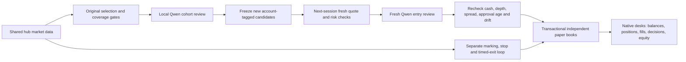

# Vanguard and CBE funded paper lanes

Activated and browser-verified at **2026-10-25 23:50:30 IST**. This supersedes the observation-only execution
boundary in README.md and QWEN.md. Real orders remain impossible in this service.

**Capital corrected at 2026-10-26 06:17:27 IST:** the owner selected ₹50 lakh per lane. Both accounts were still
untraded, with no candidates, orders, positions, fills or trading reviews. Both databases and the prior local
configuration were backed up before a guarded offline correction. The starting cash/equity baseline is now
₹50 lakh with zero return; original baseline values are retained in an explicit audit event and backup. Account
ids, activation times, risk policy and earlier pause/resume events are unchanged. Effective Compose configuration
is persisted at ₹50 lakh. The correction passed three isolated tests and both books' SQLite integrity checks;
the service was recreated and its API confirms the new capital. Evidence: platform `backups/capital-correction-20261026/`.

Both lanes start with **₹50,00,000 of independent simulated cash**. They use new SQLite books under
`runtime/paper_lanes/{vanguard,cbe}.sqlite3`; neither old Nomad accounts nor earlier shadow cohorts seed trades.
Capital and admission policy are frozen with each account; an owner-authorized, audited offline correction is
allowed only before either book has any candidate/trading activity. Restarting cannot re-fund it. The original Nomad
books, positions, returns and watchlists remain available through the separate read-only history scope.

## Trading policy

| Rule | Vanguard | CBE |
|---|---|---|
| Instrument | Exact `NSE_FO` stock options, whole contract lots | Exact `NSE_EQ` cash stock, long only |
| Selection | Existing frozen direction/payoff models and 80% freshness gates | Existing daily 5/20 momentum, relative momentum and EMA20/50 policy |
| Holding horizon | Frozen candidate's 1–3 trading sessions | One trading session |
| Entry window | Next session 09:20–09:55 IST | Next session 09:20–09:55 IST |
| Planned exit | Horizon session 15:15 IST; expiry day 15:10 IST | Horizon session 15:15 IST |
| Position / gross / sector cap | 5% / 40% / 20% of current equity | 10% / 100% / 30% of current equity |
| Stop / target | 15% / 30% from paper entry | 5% / 10% from paper entry |
| Maximum spread | 3% | 1% |
| Adverse fill slippage | 15 basis points | 5 basis points |
| Estimated fee | 10 basis points per side | 10 basis points per side |
| Sale proceeds | Immediately credited in the paper simulation | Unsettled until next session 09:15 IST |

Both books allow at most ten open positions and block new entries after a 3% daily equity loss. New quantity
must fit available cash including fees, remaining gross/sector capacity, both displayed L1 quantities, and 1% of
reported cumulative session volume. Unknown sectors share one conservative `UNKNOWN` bucket. Contract lots,
expiry and tick metadata must exist; cash ticks come from the hub master. Missing metadata is journaled and
never replaced by guessed lot sizes or ticker aliases.

These are explicit simulation policies. The source rankers were not retrained for the new next-morning entry,
holding rules, fills or costs. Their old scores/returns do not validate this paper policy or Qwen's edge.

## Fill and accounting boundaries

Only timezone-stamped broker quotes from the same session, at most ten seconds old, may fill. Every fill needs
positive bid/ask prices, displayed sizes and volume. A buy crosses the ask plus adverse slippage; a sell crosses
the bid minus adverse slippage; both round against the trader to the instrument tick. Entry uses whole lots,
and exit requires enough displayed bid quantity for the entire held position. Insufficient depth waits rather
than fabricating a full or partial fill. There is no LTP-only fill, historical replay, substituted expiry, zero-price
expiry write-off, queue-position simulation or market-impact model. An unquotable expired contract stays open
and stale until a real valuation/disposition policy is deliberately implemented; it is never silently settled.

Cash, fees and realized P&L use integer paise. Equity includes unsettled proceeds and open liquidation value
after estimated exit costs. Equity reconciles to initial capital plus realized and unrealized P&L. Unique buy/sell
fills, immutable cohort receipts and atomic SQLite transactions protect restart/retry behavior. Exit transactions
commit before entry processing, and each book's cycle is isolated so an entry error cannot roll back another
book's exits. Max drawdown and prospective equity are persisted, not imported from research.

The shared hub batches the union of both books' exact instruments into one bounded Upstox quote request per
five-second marking cycle, with a one-second hub cache and caller `macd-paper-lanes`. Standing subscriptions
replace that caller's own set; an empty set is cleared. There is no direct broker client or order endpoint.
No quote fetch runs outside the exchange session. Candidate reconciliation, marking/exits and Qwen entry
reviews have separate asynchronous loops. No historical download or recovery hold was changed.

## Qwen boundary and controls

The existing serialized local `qwen3.5:9b` service now accepts CBE as well as Smart/Vanguard. It filters eligible
prospective cohorts, then reviews fresh next-session entries separately. Deterministic admission runs before
and after inference. An approval is limited to the exact candidate id and reviewed quantity, expires after thirty
seconds, and needs another review after more than 2% quote drift. Reject/wait, timeout, malformed output or
missing model blocks a new entry. Up to three entry attempts are allowed, at least sixty seconds apart, within
the original window. Missed entries expire permanently. Qwen cannot resize risk, change stops or issue exits.
Stops, targets, time exits and settlement do not call Qwen and remain active while entries are paused.

Authenticated APIs are `GET /api/paper-lanes/{lane}` and `POST /api/paper-lanes/{lane}/control`, accepting only
`{"action":"pause"}` or `{"action":"resume"}`. The native `#/VANGUARD` and `#/CBE` desks provide balances,
positions, pending/rejected orders and their admission reasons, closed trades, fills/costs, Qwen decisions and
prospective equity charts. Neither controls nor APIs expose reset, live execution or legacy-book mutations.

## Verification and remaining limits

- 103 offline Python checks pass across new paper accounting, service controls/auth, shared quotes, existing
  Smart/Qwen integrations, shadow/retained readers and gateway routes. Platform console's 33 checks pass.
- Frontend TypeScript/Vite build and all 88 frontend tests pass. Both native paper desks, equity view and each
  lane's pause/resume were browser-checked; both were restored to entries enabled. Retained CBE still shows
  its separate one open and 206 closed records.
- One isolated live CBE model review rejected a fictional insufficient-evidence fixture in 21.488 seconds.
  Its temporary journal was separate from production; production Qwen decisions remain empty. Ollama reports
  no loaded model afterward. Live-session model latency, ten-candidate batch latency and host feed-resource
  effects remain unproved.
- Fresh accounts retain identical ids/capital/cash across a service restart; both SQLite integrity checks pass.
  There are zero new orders, positions, fills or trading reviews. Four explicit pause/resume audit events are
  expected from browser verification, two per lane. No fixture trade was written into production.
- All seven protected existing MACD books, all 33 protected Nomad tables, three configuration/credential hashes,
  and the retained CBE book/journal hashes match. Engine source/installed parity is 88/88 modules. All twenty
  current frontend assets match their served bytes.
- At **2026-10-25 23:50:02 IST**, a read-only retained-session diagnostic finds Vanguard 212/213 spot histories
  but **0/213 combined fresh feature sets**, so the unchanged 80% gate blocks selection. Both frozen model
  artifacts exist. CBE ranks the retained completed session (212/213); it does not publish that old cohort.
- First new candidates can freeze in the next eligible pre-close window, subject to inputs and Qwen. Only a
  fresh cohort can admit trades in the following session. Nothing queues old Friday signals for Monday's open.
  Activation is not an observed open-session paper cycle or a profitability claim. Shared-feed parity, broker
  refresh/warm-up issues and recovered-history gaps in the platform plumbing audit remain separate blockers.

Evidence, snapshots, screenshots and build logs are in the platform's `backups/paper-upgrade-20261025/`.
Images: `macd-mini-parallel-{engine,frontend}:paper-lanes-qwen-20261025`; previous Qwen/observation images remain
available for rollback. No image, package, model or market archive was downloaded for this upgrade.

To roll back execution without deleting data, pause both lanes, retain their journals, set `PAPER_LANES_ENABLED`
to false for the lane service, restore the saved previous engine/frontend image tags and recreate those services
without build/pull. Existing funded paper positions would then need deliberate management before leaving them
unmanaged. Never delete/reset a journal as a rollback step.
