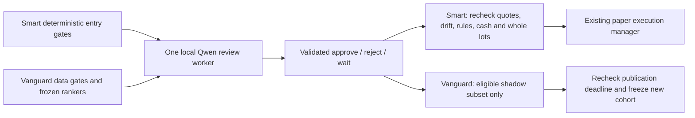

# Local Qwen decision reviews

**Training progress at 2026-10-26 08:13:00 IST:** see [QWEN_TRAINING_20261026.md](QWEN_TRAINING_20261026.md). MACD is preserved
per the owner's latest instruction. Smart research adapters and historical-data qualification are separate from
the original weights still served in trading. Vanguard/CBE have separate small reconstructed research datasets,
with zero examples meeting verified historical-availability requirements; no trained adapter is deployed.

**Update at 2026-10-25 23:50:30 IST:** Vanguard and CBE now have independent funded paper books and fresh-entry
Qwen reviews. See [PAPER_LANES.md](PAPER_LANES.md) for the current execution policy and validation. The original
deployment record below describes the earlier observation-only Vanguard boundary.

Deployed and browser-checked at **2026-10-25 23:05:33 IST**. Owner-selected model: `qwen3.5:9b`, Ollama 0.40.11,
local MLX runner. No model/package download, cloud inference, real order, model training or agentic-lane test call.

## Decision boundary

Both Smart capital books now apply a Qwen **filter to new entries**. All deterministic eligibility checks run first.
The model may approve, reject or wait, with a short reason. It cannot invent an instrument, quantity, price, stop,
target or exit action. An approval runs the full original admission path again using the current clock, cutoff,
fresh price, cash and lot calculations. Approval expiry and a 2% maximum reference-price drift are additional
guards. A rejection/wait is journaled as `QWEN_REJECTED`; service failure as `QWEN_UNAVAILABLE`; stale approval as
`QWEN_STALE`. Existing position exits and markings do not wait on model inference.

Vanguard calls Qwen only after its existing data/model gates pass for a new prospective cohort. Only the original
eligible exact instruments may survive the review. Filtered cohorts receive a `-qwen35-filter-v1` policy suffix;
old cohorts and their outcomes are untouched. A review finishing outside the publication window cannot publish.
Vanguard remains observation-only, with no funded execution. CBE and the Grok Agentic lane are unchanged.

## Shared service and records

`local-decisions` is an internal Compose service on port 8435, reusing the existing Python image. Its SQLite file
is `runtime/local_decisions/reviews.sqlite3`, separate from trading books and the Vanguard observation journal.
Successful reviews append their exact bounded input, local model digest, context hash, validated verdicts,
timestamps and latency. Identical current inputs share a short cached review across Smart books; one async lock
permits only one inference at a time. A missing model never triggers a pull or cloud fallback.

Only loopback / `host.docker.internal` is allowed for Ollama; redirects and environment proxy routing are disabled.
The model gets scalar market features, not broker/API credentials or trading tools. The native Ollama chat request
uses a fixed JSON schema, temperature 0, thinking off, 4096 context tokens, 640 output tokens and `keep_alive: 0`.
Calls have bounded HTTP/queue deadlines; failures hold new filtered entries. The service container is limited to
384 MiB; model inference runs on the Mac. These controls do not establish a live-session latency or resource guarantee.

The engine's authenticated GET `/api/local-decisions` exposes service/model availability and recent reviews.
Smart lanes and the fresh Vanguard page display the same status panel. Viewing them does not run inference.
Model availability is separate from market-data readiness and performance evidence. Earlier returns shown in
existing Smart cards predate Qwen and are not evidence of Qwen's edge.

`LOCAL_DECISION_MODE=filter` and `LOCAL_DECISION_URL=http://local-decisions:8435` are explicit Compose environment
settings on engine and shadow worker. The code defaults to `off` when unconfigured; `shadow` records reviews while
retaining deterministic admission. Production uses `filter`. Disabling requires an intentional Compose override
and engine/shadow restart; no panel can silently relax this policy.

## Existing model storage repair

All 789 referenced config/tensor layers existed at their recorded sizes, totaling about 7.64 GB, but Ollama's
configured model root was the nested directory
`~/.ollama/models/manifests-v2/ollama.com/library/qwen3.5`. The running API initially listed no models.
Empty `blobs`/`manifests` directories there were preserved under the platform's `backups/qwen-20261025/`, then
linked to the existing real stores. A direct model-manifest alias exposes the installed v2 manifest. No model bytes
were moved/deleted/downloaded; no macOS system settings, LaunchAgents or Ollama launch environment were changed.
The exact reversible link inventory is in `backups/qwen-20261025/model-path-links.json` in the platform repo.
Ollama now lists `qwen3.5:9b`; its digest at verification was
`d63f830f28d515fefea546f213fca7a75e9dd5176ef51a6deabc952d1c99a911`.

## Verification and limits

- **76 offline Python tests pass**, covering sharing/caching, strict output identity/schema, missing models, auth, stale inputs,
  Smart veto/failure, post-inference price/cash checks, existing paper fills, Vanguard breadth and deadline guards.
- Frontend production build and 88 frontend unit tests pass; Smart and Vanguard panels were browser-checked.
- One isolated structured-JSON test took 28.49 seconds cold. A full isolated service review took 16.59 seconds and
  rejected its fictional integration candidate. Both were fixture checks outside production journals, with no
  paper or real order interface. Ollama `/api/ps` subsequently returned no loaded models, confirming unload.
- All seven MACD protected trade-book table fingerprints and all 33 protected Nomad table fingerprints match
  the pre-deployment snapshots. Settings, credentials and Agentic brain configuration hashes match. Engine
  source/installed parity is 88/88 modules. Production review journal and new Vanguard cohort/outcome counts
  remain zero at verification; paper mode and the live-order lock remain intact.

Live trade-cycle and full ten-candidate Vanguard latency/resource tests remain pending. The Mac already has
substantial swap usage; one worker and model unloading constrain added load but do not prove intraday feed safety.
The broker-routing, expiry selection, warm-up and Vanguard derived-feature gaps in the platform's
`docs/PLUMBING_AUDIT_20261025.md` remain open. Qwen cannot bypass them. No profitability or strike-rate claim is made.

Evidence/build logs/screenshots: platform `backups/qwen-20261025/`. Images:
`macd-mini-parallel-{engine,frontend}:qwen-review-20261025`; earlier `nomad-ui-20261025` images are retained.
Protocol references: [Ollama chat](https://docs.ollama.com/api/chat),
[structured outputs](https://docs.ollama.com/capabilities/structured-outputs).
